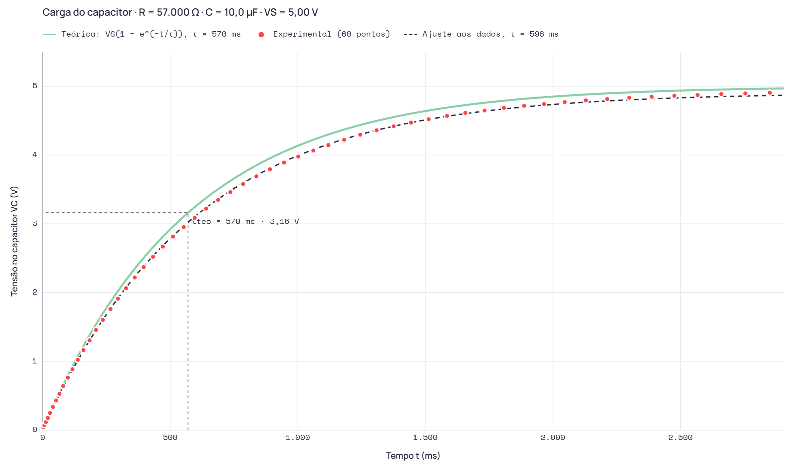

# Relatório da Ponderada 1 · Circuito RC de carga

**Aluno:** Manuella Cunha Borges Lima · manuella.lima@sou.inteli.edu.br
**Turma:** T24 · **Bancada:** ESP32-S3 1045
**Previsão registrada em:** 20/10/2026, 14:01:06 · último registro: 20/10/2026, 14:24:07 · alterada em: 20/10/2026, 14:19:25
**Primeiro dado registrado em:** 20/10/2026, 14:06:30 · **atenção: previsão registrada ou alterada depois do primeiro dado**

## 1. Contextualizar (previsão)
| Grandeza | Valor |
|---|---|
| R nominal | 57000 Ω |
| C nominal | 10 µF |
| Tolerância de fábrica | R ±5 % (faixa dourada), C ±20 % |
| Tensão da fonte V_S | 5 V |
| τ teórico (aluno) | 570 ms |
| Conta | 57 000 Ω × 10 µF = 570 000 µs = 570 ms = 0,57 s |
| V_C esperada em t = τ | 3.16 V |
| Tolerância aceitável | 25 % |

**Justificativa da tolerância:** O capacitor eletrolítico possui tolerância típica de ±20%, enquanto os resistores apresentam tolerância de ±5% (faixa dourada). Assim, a constante de tempo, calculada pelo produto da resistência pela capacitância (T = R × C), pode apresentar uma variação de até aproximadamente 25% devido às tolerâncias dos componentes. Além disso, a tensão de saída do pino D8 pode diferir ligeiramente de 5 V, e a resolução do ADC do Arduino, de aproximadamente 5 mV, também influencia as medições. Portanto, considero aceitável uma diferença de até 25% entre os valores teórico e experimental da constante de tempo.

Curva esperada: V_C(t) = 5 · (1 − e^(−t / 570 ms)). A curva teórica aparece no gráfico da etapa 4.

## 2. Consultar
- **Ferramenta:** Claude
- **Pergunta (exata):** Na dedução da carga do RC, chego em dV/dt = (VS − V)/(RC). Por que, ao separar as variáveis e integrar, aparece um logaritmo, e como a condição inicial V(0) = 0 define a constante de integração e leva a VC(t) = VS(1 − e^(−t/RC))?
- **O que acrescentou:** A resposta mostrou que o logaritmo vem da integral de 1/(VS − V) e que V(0) = 0 fixa a constante como −ln(VS), e me fez perceber que a linearização usada no Confrontar, −ln(1 − V/VS) = t/τ, é exatamente essa etapa da dedução antes de aplicar a exponencial.

## 3. Construir (dados da bancada)
- **Instrumento:** Arduino UNO, ADC 10 bits no pino A0 (resolução ≈ 4,9 mV)
- **V_S medida (final estabilizada):** 4.907 V
- **Pontos:** 60 · 27 até 1 τ teórico

| # | t (ms) | V_C medido (V) | V_C teórico (V) | Desvio (V) |
|---:|---:|---:|---:|---:|
| 1 | 0 | 0,020 | 0,000 | 0,020 |
| 2 | 1 | 0,024 | 0,009 | 0,015 |
| 3 | 3 | 0,044 | 0,026 | 0,018 |
| 4 | 7 | 0,073 | 0,061 | 0,012 |
| 5 | 13 | 0,117 | 0,113 | 0,004 |
| 6 | 20 | 0,176 | 0,172 | 0,004 |
| 7 | 29 | 0,249 | 0,248 | 0,001 |
| 8 | 40 | 0,337 | 0,339 | -0,002 |
| 9 | 53 | 0,430 | 0,444 | -0,014 |
| 10 | 66 | 0,528 | 0,547 | -0,019 |
| 11 | 81 | 0,640 | 0,662 | -0,022 |
| 12 | 99 | 0,762 | 0,797 | -0,035 |
| 13 | 117 | 0,885 | 0,928 | -0,043 |
| 14 | 138 | 1,022 | 1,075 | -0,053 |
| 15 | 160 | 1,163 | 1,224 | -0,061 |
| 16 | 184 | 1,305 | 1,379 | -0,074 |
| 17 | 209 | 1,457 | 1,535 | -0,078 |
| 18 | 236 | 1,603 | 1,695 | -0,092 |
| 19 | 266 | 1,760 | 1,865 | -0,105 |
| 20 | 295 | 1,911 | 2,020 | -0,109 |
| 21 | 327 | 2,063 | 2,183 | -0,120 |
| 22 | 361 | 2,219 | 2,346 | -0,127 |
| 23 | 396 | 2,370 | 2,504 | -0,134 |
| 24 | 433 | 2,522 | 2,661 | -0,139 |
| 25 | 471 | 2,669 | 2,812 | -0,143 |
| 26 | 511 | 2,815 | 2,960 | -0,145 |
| 27 | 553 | 2,952 | 3,105 | -0,153 |
| 28 | 596 | 3,084 | 3,243 | -0,159 |
| 29 | 641 | 3,221 | 3,376 | -0,155 |
| 30 | 688 | 3,348 | 3,505 | -0,157 |
| 31 | 736 | 3,460 | 3,625 | -0,165 |
| 32 | 786 | 3,578 | 3,741 | -0,163 |
| 33 | 838 | 3,690 | 3,851 | -0,161 |
| 34 | 891 | 3,793 | 3,953 | -0,160 |
| 35 | 946 | 3,891 | 4,049 | -0,158 |
| 36 | 1.002 | 3,978 | 4,138 | -0,160 |
| 37 | 1.061 | 4,066 | 4,223 | -0,157 |
| 38 | 1.120 | 4,145 | 4,299 | -0,154 |
| 39 | 1.182 | 4,223 | 4,371 | -0,148 |
| 40 | 1.245 | 4,296 | 4,437 | -0,141 |
| 41 | 1.309 | 4,360 | 4,497 | -0,137 |
| 42 | 1.376 | 4,418 | 4,553 | -0,135 |
| 43 | 1.444 | 4,472 | 4,603 | -0,131 |
| 44 | 1.513 | 4,521 | 4,648 | -0,127 |
| 45 | 1.585 | 4,570 | 4,690 | -0,120 |
| 46 | 1.657 | 4,614 | 4,727 | -0,113 |
| 47 | 1.732 | 4,648 | 4,760 | -0,112 |
| 48 | 1.808 | 4,687 | 4,790 | -0,103 |
| 49 | 1.887 | 4,717 | 4,818 | -0,101 |
| 50 | 1.965 | 4,741 | 4,841 | -0,100 |
| 51 | 2.046 | 4,770 | 4,862 | -0,092 |
| 52 | 2.129 | 4,795 | 4,881 | -0,086 |
| 53 | 2.213 | 4,814 | 4,897 | -0,083 |
| 54 | 2.299 | 4,834 | 4,911 | -0,077 |
| 55 | 2.387 | 4,848 | 4,924 | -0,076 |
| 56 | 2.476 | 4,863 | 4,935 | -0,072 |
| 57 | 2.567 | 4,873 | 4,945 | -0,072 |
| 58 | 2.660 | 4,888 | 4,953 | -0,065 |
| 59 | 2.754 | 4,897 | 4,960 | -0,063 |
| 60 | 2.850 | 4,907 | 4,966 | -0,059 |

## 4. Confrontar

| | τ |
|---|---|
| Teórico (R · C) | 570 ms |
| Experimental · linearização (43 pontos, R² = 0,9998) | 596 ms |
| Experimental · ponto de 63,2 % | 602 ms |
| **Experimental adotado** | **596 ms** |

- **V_S usada no cálculo:** 4,907 V (medida)
- **Método:** Linearização: ajuste de −ln(1 − V/Vs) × t
- **Como obtive:** Linearização de y = −ln(1 − V/VS) em função de t, com reta pela origem e τ = 1/inclinação. Usei VS = 4,907 V (último ponto da tabela, t = 2850 ms) e descartei os pontos acima de 95 % de VS, ficando com 46 pontos (R² = 0,9998). O método do ponto de 63,2 % dá 602 ms, o que confirma o resultado.
- **Divergência:** +4,6 % (dentro da tolerância de 25 %)

## 5. Comprovar
**Análise da divergência:** τ experimental = 596 ms contra τ teórico = 570 ms: divergência de +4,6 % (τ medido maior que o previsto), dentro da tolerância de 25 % declarada no Contextualizar. A tensão final também ficou abaixo de 5 V (≈ 4,91 V medido, assíntota ≈ 4,94 V).

| Causa física | Teste que a confirmaria |
|---|---|
| A capacitância real do eletrolítico é maior que a nominal de 10 µF (tolerância de ±20 %). Como τ = R·C, um C maior aumenta τ na mesma proporção: +4,6 % corresponderia a C ≈ 10,5 µF. | Medir C com o capacímetro do multímetro (ou um medidor LCR), com o capacitor descarregado e fora do circuito, e recalcular R·C com o valor medido. |
| A resistência efetiva da malha é maior que os 57 kΩ nominais: tolerância de ±5 % do resistor, somada à resistência dos contatos da protoboard, dos jumpers e à resistência de saída do pino D8. R maior aumenta τ. | Medir R fora do circuito com o ohmímetro, depois medir a resistência total entre D8 e o nó do capacitor na montagem, e recalcular τ com o R real. |
| Corrente de fuga do eletrolítico: funciona como uma resistência em paralelo com C, fazendo a tensão estabilizar abaixo de 5 V (≈ 4,94 V). Isso torna a VS usada no cálculo ambígua e desloca o τ extraído. | Carregar o capacitor, colocar D8 em alta impedância (pinMode INPUT) e registrar pelo A0 quanto a tensão cai ao longo de alguns minutos; uma queda lenta indica a fuga e permite estimar a resistência de fuga. |

### Pergunta de transferência (sem consulta)
- **Pergunta:** Qual é a diferença do que era esperado teoricamente e a real saída do experimento?
- **Resposta:** A teoria previa τ = R·C = 570 ms e que o capacitor chegaria a 5 V, com 3,16 V em t = τ. Na bancada, o τ medido foi de 596 ms, 4,6 % maior, então a carga foi um pouco mais lenta. A tensão estabilizou em cerca de 4,91 V, e não em 5 V. A diferença está dentro da tolerância de 25 % e se explica principalmente por C e R reais maiores que os nominais (tolerâncias de ±20 % e ±5 %). A fuga do eletrolítico e a VS real abaixo de 5 V explicam a tensão final menor.

Declaro que as medições são da bancada e que respondi a pergunta de transferência sem consulta: sim
